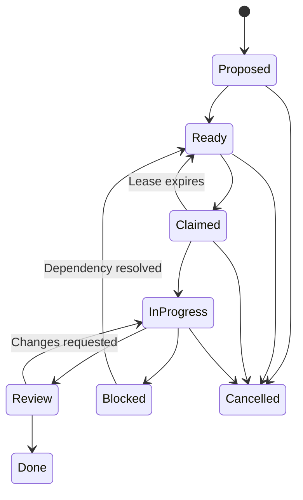

# Coordination protocol

**Status:** Proposal  
**Implementation status:** Not started  
**Scope:** Messages, task ownership, decisions, and shared state

This document defines protocol requirements for communication among independent agents and the runtime. It does not select a transport, database, or model provider.

## 1. Principles

- Every message has a type, sender, and project scope.
- Messages express information or intent; they do not bypass authorization.
- Important messages are persisted before they are treated as accepted.
- Delivery may be retried, so consumers must handle duplicates.
- State transitions are validated by the control plane.
- Large artifacts are referenced by identifier rather than embedded in messages.
- Discussions and tasks remain traceable to the user objective.

## 2. Message envelope

The following is illustrative, not a finalized schema:

```json
{
  "message_id": "msg_example",
  "project_id": "project_example",
  "sender_agent_id": "agent_research",
  "recipient": {
    "kind": "agent",
    "id": "agent_engineer"
  },
  "message_type": "proposal",
  "created_at": "2026-11-26T10:00:00Z",
  "correlation_id": "task_example",
  "causation_id": null,
  "project_revision": 12,
  "payload": {
    "summary": "Use a scoped change set for the task.",
    "rationale": "The task may overlap with another agent's work.",
    "artifact_refs": []
  }
}
```

The implementation must define identifier generation, timestamp rules, field validation, and size limits.

## 3. Initial message types

| Type | Meaning | State effect |
| --- | --- | --- |
| proposal | Suggests an approach | None |
| finding | Publishes an observation with evidence | Adds a validated finding |
| question | Requests information | None |
| challenge | Raises an objection or risk | Adds a challenge record |
| task_offer | Offers to perform work | None |
| task_claim | Requests ownership | Granted only after validation |
| task_update | Reports progress or a blocker | Validated transition |
| review | Evaluates an artifact or task | Adds a review record |
| decision_proposal | Suggests an outcome | None |
| decision_finalized | Records an authorized outcome | Follows decision policy |
| artifact_published | References a change or artifact | Requires artifact validation |

The initial type set should remain small. Add a type only when it represents distinct behavior.

## 4. Routing and delivery

The protocol should support direct agent messages, task-scoped communication, project-level announcements, and runtime acknowledgements or errors.

For the first implementation, persisted messages with at-least-once delivery and idempotent consumers are sufficient. Exactly-once delivery must not be assumed.

Global ordering is unnecessary. Where ordering matters, preserve it within a task or decision stream and use project revisions to detect stale writes.

## 5. Task state

A proposed task lifecycle is:



A task record should include a stable identifier, project identifier, expected output, acceptance criteria, required capabilities, dependencies, state, owner, lease expiry, artifact references, completion evidence, retry count, and failure reason.

### Claims and leases

An agent may request a claim. The control plane verifies that the task is ready, dependencies are satisfied, the agent meets capability requirements, and no conflicting claim exists.

Claims should use bounded leases. Two simultaneous requests for one exclusive task must not both succeed. Expired claims should return to a recoverable state after the runtime determines whether the previous execution is still active.

## 6. Dependencies and scheduling

The first prototype may represent tasks as a directed acyclic graph. A task becomes ready only when its required predecessors are complete.

Scheduling may consider capability fit, current load, provider availability, estimated model cost, and task priority. It must not assign work silently based only on a role label.

A dependency cycle is an invalid plan and must be reported before execution.

## 7. Decisions and disagreement

A proposal is not a decision. A challenge is not automatically a veto. Message volume is not consensus.

A decision record should contain:

- the question and scope;
- proposed options;
- supporting evidence;
- objections and unresolved risks;
- the decision policy;
- the authorized outcome and authority;
- timestamp and project revision.

The prototype should use an explicit decision policy. Depending on the decision, authority may belong to the user, a configured policy, or a designated reviewer.

When discussion exceeds its time or token budget, stop the loop and record an unresolved decision or request user input.

## 8. State consistency

Shared project state is authoritative; agent-local context is a working copy.

Agents submit proposed changes against a known project revision. The control plane commits a valid change or returns an explicit stale-state or conflict response.

Optimistic concurrency is a reasonable starting point. Silent last-write-wins behavior is unacceptable for requirements, decisions, ownership, or other critical records.

## 9. Failure and retries

The runtime must distinguish transient provider failures, permanent provider errors, malformed messages, unauthorized operations, stale revisions, expired claims, agent timeouts, task failures, project cancellation, and budget exhaustion.

Retries must be bounded and use backoff where appropriate. Non-idempotent operations require an operation identifier and a deduplication check.

## 10. Decisions still open

Before implementation, decide how messages are stored, how project revisions are allocated, how long claims last, how agent identity is authenticated, which routing patterns are necessary, how artifacts are referenced, and how cancellation propagates.

Do not finalize transport or storage technology until these requirements are understood.
