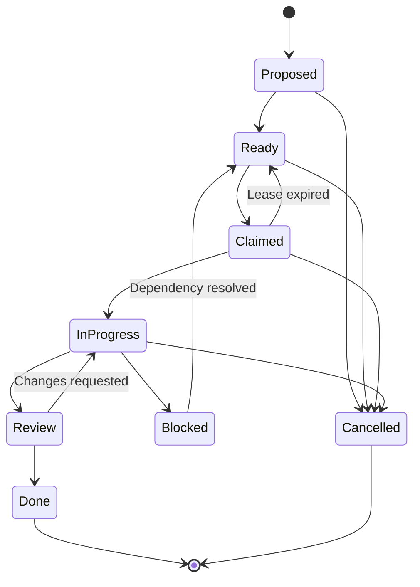

# Coordination Protocol

**Status:** Proposal for the first prototype  
**Scope:** Agent messages, task ownership, decisions, and shared state

This document defines the initial protocol requirements for communication between independent agents and the runtime. It is intentionally transport-agnostic. It does not select HTTP, WebSocket, a message broker, or a specific database.

## 1. Protocol principles

- Messages have explicit types and project scope.
- Every message has an attributable sender.
- Messages are persisted before they are considered accepted.
- Message delivery may be retried; consumers must handle duplicates.
- Messages express information or intent. They do not bypass runtime authorization.
- State transitions are validated by the control plane.
- Large artifacts are referenced by identifier rather than embedded in messages.
- Every discussion and task should be traceable to the user objective.

## 2. Message envelope

The following is an illustrative envelope, not a finalized schema:

```json
{
  "message_id": "msg_01...",
  "project_id": "prj_01...",
  "sender_agent_id": "agent_architect",
  "recipient": {
    "kind": "agent",
    "id": "agent_engineer"
  },
  "message_type": "proposal",
  "created_at": "2026-01-01T12:00:00Z",
  "correlation_id": "task_01...",
  "causation_id": null,
  "project_revision": 12,
  "payload": {
    "summary": "Use an isolated workspace for the first implementation.",
    "rationale": "The task contains files that may be edited concurrently.",
    "artifact_refs": []
  }
}
```

The example uses placeholder identifiers and values. The protocol implementation must define validation, size limits, timestamp rules, and identifier generation.

### Required fields

| Field | Purpose |
| --- | --- |
| message_id | Unique identifier used for deduplication |
| project_id | Project boundary |
| sender_agent_id | Originating agent |
| recipient | Agent, task, or project-level destination |
| message_type | Typed message intent |
| created_at | Message creation time |
| correlation_id | Related task or discussion |
| causation_id | Message or event that caused this message |
| project_revision | State revision observed by the sender |
| payload | Type-specific content |

## 3. Initial message types

| Type | Meaning | Does it mutate authoritative state? |
| --- | --- | --- |
| proposal | Suggests an approach or change | No |
| finding | Publishes an observation with evidence | Adds a finding record after validation |
| question | Requests information | No |
| challenge | Raises an objection or risk | No |
| task_offer | Offers to perform work | No |
| task_claim | Requests ownership of work | Only after control-plane validation |
| task_update | Reports progress or a blocker | Validated state transition |
| review | Evaluates an artifact or task | Adds a review record |
| decision_proposal | Suggests a decision | No |
| decision_finalized | Records an authorized outcome | Only under decision policy |
| artifact_published | References a new artifact or change set | After artifact validation |

The first implementation should keep message types small. New types should be added only when they represent distinct behavior that cannot be expressed cleanly with existing types.

## 4. Routing and delivery

The protocol should support:

- direct agent-to-agent messages;
- task-scoped communication;
- project-scoped announcements;
- runtime-generated acknowledgements and errors.

The transport is separate from message semantics. A message should retain the same meaning whether it is delivered through an in-process queue or a future distributed transport.

For the first implementation, use persisted messages with at-least-once delivery and idempotent consumers. Exactly-once delivery should not be assumed. A consumer must record processed message identifiers or use idempotent state operations.

Global ordering is not required. The runtime should preserve ordering where needed within a task or decision stream and use project revisions to detect stale writes.

## 5. Task state machine

A proposed task lifecycle:



A task record should include:

- stable task identifier;
- project identifier;
- expected output and acceptance criteria;
- required capabilities;
- dependency identifiers;
- current state;
- current owner or collaborating agents;
- lease or claim expiry, where applicable;
- artifact references;
- completion evidence;
- retry count and failure reason.

### Claims and leases

An agent may request a task claim. The control plane validates that the task is ready, its dependencies are satisfied, the agent meets the capability requirements, and no conflicting claim is active.

A claim should have a bounded lease. The agent must renew it while actively working. If the lease expires, the task returns to a recoverable state after the runtime checks whether the previous execution is still active.

Claims must be atomic. Two simultaneous claims for one exclusive task must not both succeed.

## 6. Dependencies and scheduling

Tasks form a directed acyclic graph for the initial prototype. A task is ready only when all required predecessors are complete.

The scheduler may use capability fit, current load, provider availability, estimated cost, and task priority to identify suitable agents. It should not silently assign work based only on role labels.

A cycle in the dependency graph is an invalid plan and must be reported before execution.

## 7. Decisions and disagreement

A proposal is not a decision. A challenge is not a veto. A message count is not consensus.

Every decision record should contain:

- decision identifier and scope;
- question being resolved;
- proposed options;
- supporting evidence;
- objections and unresolved risks;
- decision policy used;
- final outcome;
- decision authority;
- timestamp and related project revision.

The first prototype should support an explicit decision policy rather than claim that models can reliably reach consensus. Depending on the decision, the authority may be a user, a configured policy, or a designated reviewer. Any policy must be visible and auditable.

When a discussion exceeds its time or token budget, the runtime should stop the loop and either record an unresolved decision or request user input.

## 8. State consistency

The project state is authoritative; agent-local context is a working copy.

Agents should submit proposed changes against a known project revision. The control plane validates and commits the change or rejects it as stale.

For the first prototype, optimistic concurrency with explicit conflict responses is a reasonable starting point. Silent last-write-wins behavior is not acceptable for requirements, decisions, task ownership, or other critical records.

## 9. Failure and retry behavior

The runtime must distinguish between:

- transient provider failure;
- permanent provider or tool error;
- malformed message;
- unauthorized operation;
- stale state revision;
- expired claim;
- agent timeout;
- task failure;
- project cancellation;
- resource-budget exhaustion.

Retries must be bounded and use backoff for transient failures. Non-idempotent operations must not be repeated without an operation identifier and deduplication check.

## 10. Protocol questions to resolve

Before implementation, decide:

- whether messages are append-only events or separate records with mutable delivery state;
- how project revisions are allocated;
- how long task claims should last;
- how agent identity is authenticated within a runtime;
- which destinations and fan-out patterns are required;
- how large payloads and artifacts are referenced;
- how cancellation propagates through dependent work.

Do not finalize a transport or storage technology until these requirements are understood.
