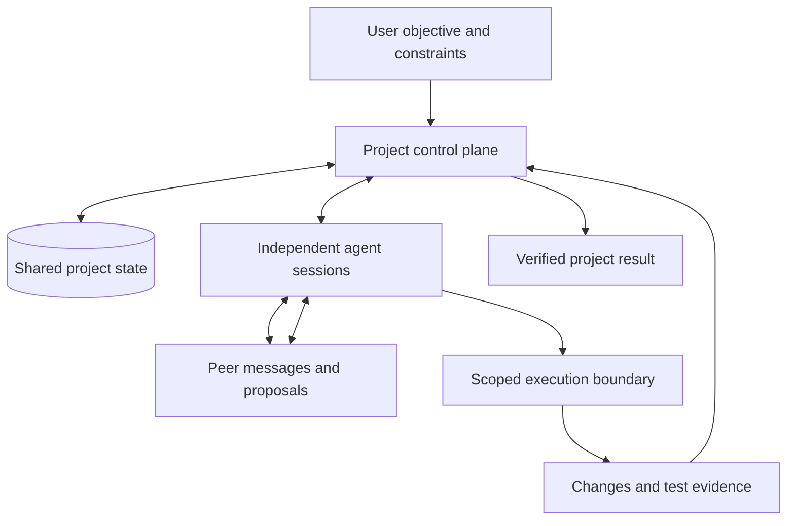

# Fellows architecture overview

**Document status:** Proposed  
**Implementation status:** Not started  
**Initial domain:** Collaborative software engineering

This document describes the system Fellows intends to investigate. It is a design proposal, not a description of a working runtime.

## 1. Thesis

Fellows explores a peer-first collaboration model for independent AI agents.

Agents should be able to communicate directly, share findings, challenge proposals, negotiate bounded work, and review artifacts. No single model should be required to act as the permanent reasoning supervisor.

Peer reasoning alone is not enough. A dependable system still needs an authoritative mechanism for project state, task ownership, permissions, budgets, and integration. Fellows therefore separates the **peer layer** from a **deterministic control plane**.

The control plane enforces explicit rules. It does not replace agent reasoning with another supervisory model.

## 2. Conceptual system

The diagram is conceptual. It does not prescribe separate processes, a deployment topology, or a specific technology stack.

## 3. System responsibilities

### Agent sessions

Each session represents an independent model context. An agent has an identity within a project, declared capabilities, current responsibilities, provider configuration, and access to selected project context.

An agent may publish findings, propose a plan, challenge an assumption, offer to perform a task, request ownership, or review an artifact. A message expresses intent; it does not grant authority by itself.

### Collaboration protocol

The protocol defines how agents communicate and request changes to shared state. Messages are typed, attributable, scoped to a project, and associated with a task or discussion when relevant.

The protocol should be independent of any one model provider or transport. See the [coordination protocol](COORDINATION.md).

### Shared project state

The shared state is the durable record of the work. It is expected to contain:

| Record | Purpose |
| --- | --- |
| Project | Goal, constraints, status, and acceptance criteria |
| Agent | Identity, capabilities, and lifecycle state |
| Task | Deliverable, dependencies, owner, and state |
| Message | Attributed communication and correlation data |
| Decision | Outcome, rationale, objections, and evidence |
| Artifact | File, patch, report, or test result |
| Event | An append-only account of important state changes |

The schema is not finalized. The initial design should prioritize attribution, consistency, and inspectability over scale.

### Deterministic control plane

The control plane is authoritative for:

- project and agent lifecycle;
- validation and persistence of messages;
- task ownership and dependency transitions;
- permission checks and approval requirements;
- budget and concurrency limits;
- cancellation, timeout, and recovery;
- artifact integration and completion state;
- event history.

State changes must be explicit and auditable. A model response must not silently grant permissions or commit an authoritative task transition.

### Execution boundary

Agents may need tools to inspect or modify project artifacts. The initial design should use scoped capabilities and attributable change sets rather than unrestricted shared access.

Each consequential action should record its requesting agent, requested capability, relevant inputs, approval state, and result. Sensitive values must not be copied into general event logs.

### Model-provider interface

Provider adapters should translate provider-specific request and response formats into a stable internal interface. They should expose capabilities rather than assume that every model supports the same context size, tool calling, structured output, cancellation, or usage reporting.

The project has not selected a provider or implemented an adapter.

## 4. Collaboration lifecycle

A project is expected to move through the following conceptual stages:

1. **Intake:** establish the objective, constraints, deliverables, and acceptance criteria.
2. **Interpretation:** agents independently identify requirements, unknowns, and risks.
3. **Discussion:** agents exchange proposals, evidence, questions, and challenges.
4. **Decision:** the selected policy or user records the outcome and unresolved risks.
5. **Negotiation:** agents offer and claim bounded tasks with explicit dependencies.
6. **Execution:** approved work proceeds within scoped capabilities.
7. **Integration:** changes are reviewed and incorporated through an explicit process.
8. **Verification:** the result is checked against acceptance criteria.
9. **Delivery:** the user receives artifacts, evidence, and known limitations.

Not every task needs every stage. Collaboration should be proportional to task complexity and uncertainty.

## 5. Core invariants

The design should preserve these rules:

1. Only the control plane may commit authoritative task-state transitions.
2. Every accepted message has an identifiable sender and project scope.
3. An exclusive task cannot have two active owners.
4. A task cannot be marked complete without configured completion evidence.
5. Agents cannot grant themselves permissions.
6. Every artifact change is attributable to an agent or user.
7. Retries cannot duplicate non-idempotent state changes.
8. Cancellation and budget exhaustion propagate to active work.
9. Conflicting state updates are detected rather than silently overwritten.
10. Project completion requires acceptance checks or an explicit user override.

These invariants should become tests before the runtime expands.

## 6. Failure model

The system should expect partial failure: provider timeouts, agent silence, expired claims, tool errors, stale updates, conflicting changes, unresolved disagreement, and budget exhaustion.

Failures should become explicit events. Recovery may involve a bounded retry, releasing a claim, reassignment, requesting user input, or stopping the project. Infinite retries and unbounded discussion loops are unacceptable.

## 7. Security and trust

Model output, agent messages, repository content, websites, and tool results are untrusted input.

The runtime should enforce least-privilege permissions, project isolation, explicit secret handling, bounded execution, provenance for messages and artifacts, and user approval for consequential external or destructive actions.

An agent message is never a policy update. Permissions are controlled by the runtime under user-defined policy.

## 8. First implementation boundary

The first prototype should test only the minimum needed to evaluate the thesis:

- three independent agent sessions;
- one shared project state;
- typed peer messages;
- task offers and exclusive claims;
- a small dependency-aware task board;
- controlled artifact changes;
- integration and acceptance checks;
- an event history containing model usage, timing, and cost.

A single-process implementation is acceptable if it preserves the logical boundaries. A distributed architecture is not a goal in itself.

## 9. Open questions

The first implementation and experiment must resolve the storage model, event-history strategy, message delivery semantics, claim duration, decision policy, execution isolation, provider interface, budget allocation, and approval boundaries.

Record significant decisions as architecture decision records. Do not settle technology choices before the requirements justify them.

## 10. Non-goals

The first prototype is not intended to provide unlimited agents, unrestricted machine access, guaranteed model consensus, arbitrary distributed execution, or a universal framework for every domain.

The immediate research question is narrower: can peer-first reasoning backed by deterministic coordination improve a bounded software task enough to justify its additional cost and complexity?
