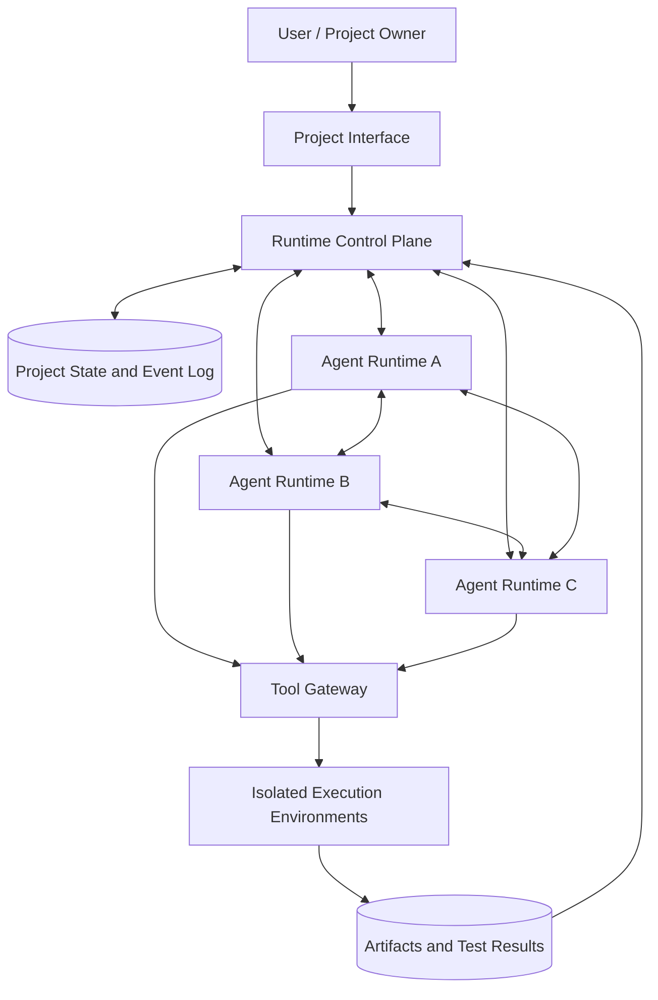
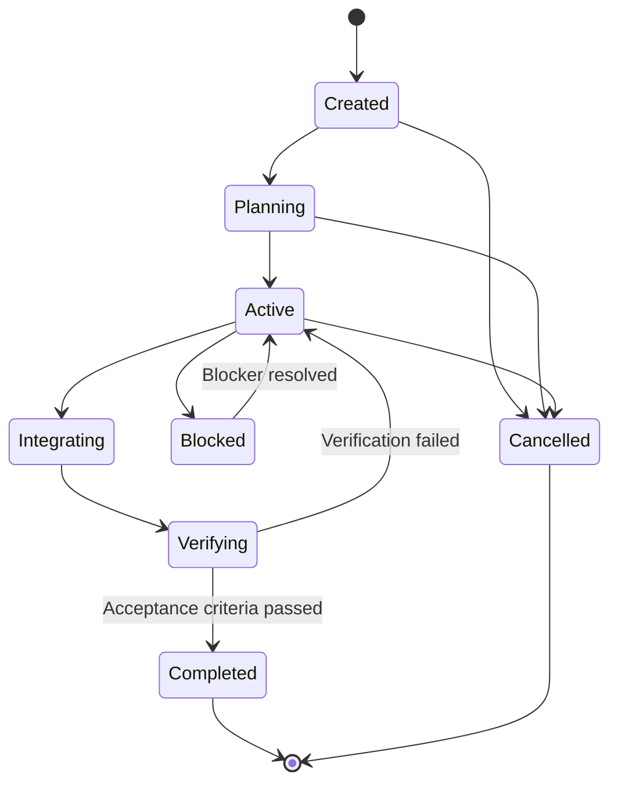

# Architecture Specification

**Document status:** Proposed  
**Implementation status:** Not started  
**Scope:** Initial collaboration runtime for software-engineering tasks

This document describes the intended system boundaries and the architectural questions that the first prototype must resolve. It is a design proposal, not a statement of implemented behavior.

## 1. Architectural thesis

Fellows separates the reasoning performed by agents from the deterministic mechanisms required to coordinate them.

Agents are peers at the reasoning layer. They own their working context, can communicate directly, and can propose or challenge work without asking a permanent lead model to relay every interaction.

A runtime control plane provides authoritative state, event persistence, task transitions, resource accounting, and policy enforcement. It is intentionally not another reasoning authority. Its job is to enforce invariants that should not depend on an LLM response.

This distinction is central to the design:

- **Peer layer:** proposes, reasons, shares knowledge, negotiates, and reviews.
- **Control plane:** validates, persists, schedules, authorizes, and tracks.
- **Execution plane:** runs tools and changes artifacts within explicit boundaries.

A system can be peer-based without being leaderless at the infrastructure level.

## 2. System context

The diagram is conceptual. It does not prescribe a deployment topology or imply that every logical component must be a separate process.

## 3. Logical components

### 3.1 Agent runtime

An agent runtime represents one independently executing model session.

An agent instance should have:

- a stable agent identifier within a project;
- declared capabilities and current responsibilities;
- provider/model configuration;
- a private working context;
- access to selected shared project context;
- a scoped tool set;
- execution limits and cancellation support;
- a way to publish messages, artifacts, findings, and task status.

Agent identity, role, and model are separate concepts. A role describes responsibility; a capability describes what the agent can do; a model is an implementation choice. Changing the model should not require changing the project protocol.

### 3.2 Collaboration protocol

The protocol defines how agents exchange information and request state changes. It must support direct peer communication while ensuring that authoritative state changes pass through validated runtime operations.

Messages are proposals or information. They are not automatically commands. For example, a task-claim message asks the control plane to acquire a task; it does not grant ownership by itself.

See [Coordination Protocol](COORDINATION.md).

### 3.3 Project state

Project state is the durable source of truth for the team. It should contain:

| Record | Purpose |
| --- | --- |
| Project | Goal, constraints, status, owner, and configuration |
| Requirement | User expectation and acceptance criteria |
| Agent | Identity, capabilities, provider, and lifecycle status |
| Work item | Deliverable, owner, dependencies, and state |
| Message | Attributed communication and correlation metadata |
| Decision | Outcome, rationale, alternatives, and evidence |
| Artifact | File, patch, report, test result, or other output |
| Execution | Tool invocation, limits, outcome, and audit metadata |
| Evaluation run | Task configuration, baseline, measurements, and result |

The exact storage schema is intentionally open. The first implementation must preserve attribution, history, and consistency before optimizing for scale.

### 3.4 Runtime control plane

The control plane performs deterministic operations:

- project and agent lifecycle management;
- validation and persistence of messages;
- task ownership and dependency transitions;
- policy and permission checks;
- budget and concurrency enforcement;
- cancellation, timeout, and recovery;
- artifact integration coordination;
- event history and observability.

It must not make unreviewable semantic decisions on behalf of the team. Where a decision requires judgment, agents can propose and evaluate options; configured policy or the user determines how it is finalized.

### 3.5 Execution plane

The execution plane provides controlled access to tools and project artifacts.

The initial implementation should favor isolated workspaces and explicit change sets over unrestricted concurrent writes to one working tree. Tool invocations should pass through a permission boundary that records the requesting agent, requested capability, inputs, and result.

### 3.6 Provider adapters

Provider adapters translate a provider's API into a common internal interface. They should expose capability metadata rather than assuming every model supports the same features.

At minimum, the interface should account for:

- text generation;
- tool calling;
- structured output;
- context-window limits;
- cancellation and timeout behavior;
- token usage and provider-reported cost;
- rate limits and retry signals.

Provider-specific features should remain accessible without leaking provider-specific assumptions into the collaboration protocol.

## 4. Execution lifecycle

A project moves through a controlled lifecycle:

The project lifecycle is distinct from an individual work item's lifecycle. A project may be active while some work items are blocked or under review.

## 5. Collaboration model

The expected workflow is:

1. **Intake:** validate the objective, constraints, deliverables, and approval boundaries.
2. **Independent interpretation:** agents identify requirements, uncertainty, risks, and possible approaches.
3. **Deliberation:** agents exchange proposals, findings, and challenges.
4. **Decision recording:** outcomes and unresolved disagreements are recorded in project state.
5. **Work negotiation:** agents identify work, dependencies, and capability requirements.
6. **Execution:** claimed work proceeds in an appropriate workspace.
7. **Integration:** changes are reviewed and applied through a controlled process.
8. **Verification:** the integrated result is tested against acceptance criteria.
9. **Delivery:** the user receives artifacts, test evidence, and known limitations.

Not every task requires a prolonged debate. Collaboration should be proportional to uncertainty and dependency, with explicit limits on time and resource consumption.

## 6. Coordination invariants

The runtime should preserve the following invariants:

1. Only the control plane can commit authoritative task-state transitions.
2. Every persisted message has an identifiable sender and project scope.
3. Task ownership cannot be acquired by two agents at the same time when the task is exclusive.
4. A task cannot become complete without its configured completion evidence.
5. Agents cannot grant themselves new tool permissions.
6. An artifact change must be attributable to an agent or a user.
7. Retries must not duplicate non-idempotent state transitions.
8. Cancellation and budget exhaustion must propagate to active work.
9. Conflicting project-state updates must be detected, not silently overwritten.
10. Project completion requires the configured acceptance checks or an explicit user override.

These invariants should become tests before the runtime is expanded.

## 7. Failure handling

The system must expect partial failure:

- a provider request times out;
- an agent stops responding;
- a task lease expires;
- a tool call fails;
- an artifact conflicts with another change;
- a dependency becomes unavailable;
- the project exceeds its budget;
- agents disagree without reaching a decision.

Failures should be represented as explicit state and events. Recovery may involve retrying, releasing a claim, assigning work to another capable agent, requesting user input, or stopping the project. The recovery policy must be bounded to prevent infinite retries and runaway cost.

## 8. Security boundaries

The architecture must assume that model output, agent messages, repository content, websites, and tool results can contain untrusted instructions.

The runtime should enforce:

- least-privilege tool permissions;
- isolation between projects and agent execution contexts;
- explicit handling of secrets;
- command, network, time, and resource limits;
- provenance for messages and artifacts;
- user approval for consequential external or destructive actions;
- auditability of tool use and state changes.

An agent message must never be treated as a policy update. Permissions are issued by the runtime under user-configured policy.

## 9. Observability

A useful system must explain why it did something, not only show that it completed.

The event history should make it possible to reconstruct:

- which agents participated;
- what context and task each agent received;
- which messages and artifacts influenced a decision;
- how task ownership changed;
- which tools were invoked and under what permissions;
- what failed, retried, or was cancelled;
- how the final result passed or failed verification;
- how much time and model/compute budget was consumed.

Sensitive inputs and secrets must be redacted from logs.

## 10. First implementation boundary

The first prototype should not attempt a general-purpose agent platform.

It should demonstrate:

- three independent agent sessions;
- one project state store;
- typed peer messages;
- task offers and exclusive claims;
- a dependency-aware task board;
- isolated or otherwise controlled artifact changes;
- integration and acceptance testing;
- an event log with cost and timing data.

A single-process implementation is acceptable initially if it preserves the logical boundaries and testable invariants. Distributed deployment should be justified by measured requirements, not assumed in advance.

## 11. Open decisions

The prototype and evaluation should determine:

- the storage model and event-history strategy;
- message delivery and retry semantics;
- task lease duration and reassignment rules;
- decision-resolution policies;
- isolation and workspace integration strategy;
- provider adapter interface;
- model selection and budget allocation;
- which operations require user approval.

These decisions should be recorded as architecture decision records when resolved.

## 12. Scope and non-goals for the first prototype

The first prototype is not intended to provide:

- unlimited autonomous agents;
- unrestricted access to the host machine;
- guaranteed consensus between language models;
- fully distributed execution across arbitrary machines;
- a universal multi-agent framework for every domain;
- claims of better performance without controlled evaluation.

The initial goal is narrower: determine whether peer-first reasoning, backed by deterministic coordination, can improve a bounded software task enough to justify its additional complexity.
